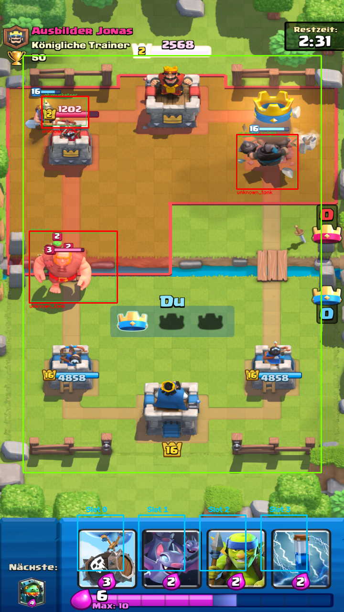

# Clash Royale Tactical AI Bot — MK Miner Skeleton Barrel Zap Bait

A modular Clash Royale bot intended to play **on an Android device over ADB**
(a phone, or BlueStacks / LDPlayer / MEmu / MuMu), using a **Hybrid YOLOv8/ONNX + OpenCV
vision pipeline**, a **utility-scoring & combo-sequencing brain** tuned for the **3.3 Elixir
Mega Knight Zap Bait** deck, and — this is what v2.1 and v2.2 rebuilt — a **capture, touch and
troop-detection layer intended for hardware**.

* **v2.1** — capture via `MultiClient`, ADB touch injection, per-device calibration, and
  optional post-deploy checks. Calibration and touch behaviour still require device validation.
* **v2.2** — foreground segmentation, tile-relative geometry and optional sprite matching.
  Card naming is conservative and currently unproven on real gameplay: the 55 labelled real
  crops in our check produced **0 correct names, 0 wrong names and 55 abstentions**. The
  deployment-based identity memory is experimental and disabled by default.

| Card | Cost | Tactical Role in the Brain |
| :--- | :---: | :--- |
| **Mega Knight** *(+ Evo)* | 7 | **Defensive Stomp & Counterpush Tank** — Evaluates ground cluster stomp value (`>= 4.0` elixir) on our half before dropping; **never** drops into P.E.K.K.A, onto air troops, or dry in Single Elixir. |
| **Miner** | 3 | **Anti-Tornado Tower Tank & Ranged Sniper** — Rotates across 4 outer King-safe tower tiles so opponents cannot predict-catch or Tornado to King; tanks right before Skeleton Barrel pops; snipes Princess/Magic Archer/Firecracker. |
| **Inferno Dragon** | 4 | **Flanking Tank Melter** — Deploys at outer/high-center safe anchors (`(1.4, 20.5)` / `(7.2, 20.2)`) to melt P.E.K.K.A, Golem, Giant, RG, Lava Hound, and enemy Mega Knights while baiting enemy Zap. |
| **Skeleton Barrel** *(+ Evo)* | 3 | **Primary Bait Win Condition & Opposite-Lane Punisher** — Sequences timed **Barrel -> 1.8s Delayed Miner** combos and punishes the opposite lane whenever the opponent invests 6+ elixir in the back. |
| **Zap** | 2 | **Timed Reset & Swarm Clear** — Waits `~1.7–2.2s` after an enemy Inferno Tower / Inferno Dragon / Sparky locks onto our push before resetting; catches Goblin Barrels & Skarmy; holds Zap when the opponent runs Log Bait. |
| **Bats** | 2 | **High-DPS Air Defense & Bait Punish** — Shreds Balloons & ground rushers; rushes behind Miner/MK whenever the opponent's small spell is tracked out of cycle. |
| **Spear Goblins** | 2 | **Center-Pull Kiter & Anti-Leak Cycle** — Pulls P.E.K.K.A, Prince, Mini P.E.K.K.A, and Bandit to center tiles (`(9.6, 20.6)` / `(8.4, 20.6)`) so **both Princess Towers** shoot them; splits behind King at `9.3+` elixir. |
| **Goblin Gang** *(Goblin Army)* | 3 | **Ground Swarm & Pocket Punisher** — Body-blocks Hog Rider/Ram/Prince (crucial since this deck runs no building!) and pressures unlocked pockets when the opponent's Log/Zap is baited. *(Can be swapped to `skeleton_army` in `configs/mk_zap_bait.yaml`.)* |

---

## What v2.1 fixed (why the old bot "captured the screen but never played")

The original build was tuned against an Android emulator at 720x1280 and worked in its own
benchmark, but on a real ADB device it had four independent defects. Any one of them is enough
to stop it playing; together they made it look completely inert.

| # | Problem | Why it broke real play | What v2.1 does instead |
| :-- | :--- | :--- | :--- |
| 1 | **Input injection varies by device** | ADB taps and swipes can be delayed or ignored. | `tap` and `drag` styles use ADB input backends; an optional hand-change check can retry. Touch success and timing need device validation. |
| 2 | **Repeated `screencap` is slow** | The bot may act on a stale frame. | `MultiClient` can use an H.264 capture stream, with `screencap` fallback. Capture and end-to-end decision rates depend on the device and vision workload. |
| 3 | **Hard-coded 9:16 geometry** | Different layouts and perspective can misplace cards or deployments. | Automatic calibration tries tower, river and hand anchors. When tower fitting fails it falls back to an approximate rectangle; inspect the preview or calibrate manually. |
| 4 | **No feedback that a touch registered** | A dropped play can desynchronise state. | The optional verifier compares the hand after a gesture and can retry; a pixel change is a heuristic, not proof of which card was played. |

Bonus: the popular `scrcpy-client` Python package packs a **31-byte**
`INJECT_TOUCH_EVENT` payload, but a scrcpy 1.24 server requires exactly **27** bytes. That
desynchronises the control reader and turns every touch into a no-op — a hidden trap for
anyone wiring up scrcpy-based input. This bot therefore never injects touches over a scrcpy
socket: input goes through `adb shell input`, and every deploy is verified on the device
before the hand model trusts it.

---

## Quick Start on a Real Phone

### 1. Prepare the device
1. Enable **Developer options → USB debugging**, plug in the phone, and accept the RSA prompt.
   *Some Xiaomi/Oppo/Vivo devices also need "USB debugging (Security settings)" to allow
   synthetic input.*
2. Keep the phone in **portrait**. The bot pins orientation, but a rotated display breaks
   coordinate mapping.
3. Install Clash Royale and equip the MK Zap Bait deck.

### 2. Install
```bash
pip install -r requirements.txt        # opencv, numpy, pyyaml, pillow, av, pytest
```

Check the link end to end:
```bash
python main.py --stats
```
This prints the detected device, resolution, whether Clash Royale is in the foreground, and
which capture/input backends will be used.

### 3. Calibrate once per device (15 seconds)
Open a **battle** (Training Camp is free) and run:
```bash
python scripts/calibrate_device.py
```
The calibrator attempts to locate the river, hand, elixir bar and towers and writes
`configs/calibration/<device>_<WxH>.json` plus a `.preview.png`. It may fall back to an
approximate rectangular arena; confidence is not a guarantee of correct geometry.

**Open the preview and check it.** The yellow grid should follow the arena, the cyan boxes
should sit on the four cards, and the red line should lie on the river. If not, click the
four tower positions yourself and recheck the preview:
```bash
python scripts/calibrate_device.py --manual
```
Headless (SSH)? Pass the four Princess Tower bases as coordinates:
```bash
python scripts/calibrate_device.py --towers "140,300;580,300;140,745;580,745"
```

### 4. Prove that touches land
```bash
python scripts/probe_placement.py
```
This tries each input backend in turn, drags your first card onto a safe tile and reports
whether the card **actually left the hand**. It writes `probe_placement.png` showing exactly
the gesture it sent. If everything says `NO-OP`, the script prints a checklist — in practice
it is nearly always an uncalibrated tray or input injection disabled at the OS level.

### 5. Play
```bash
python main.py                  # you start the battle; the bot plays it
python main.py --auto-queue     # bot also clicks Battle / OK between matches
python main.py --dry-run        # live coach: shows what it *would* play, taps nothing
```
Press `q` in the HUD window or `Ctrl+C` to stop.

---

## Using `MultiClient` directly

`cr_bot.adb.capture.MultiClient` is the capture layer. It manages one session per device and
keeps an always-latest frame:

```python
from cr_bot.adb.capture import MultiClient

mc = MultiClient(target_width=720, max_fps=30)      # or MultiClient(serials=["R58M…", "10.0.0.5:5555"])
mc.start()

frame = mc.latest_frame()                            # newest BGR frame, never a stale one
print(mc.resolution, f"{mc.fps:.1f} fps", mc.backend_used)

mc.stop()
```

Backends (`capture.backend`):

| Value | What it does |
| :--- | :--- |
| `auto` *(default)* | `screenrecord` → `scrcpy_py` → `screencap`; the first one that delivers frames wins. |
| `screenrecord` | Android's own binary: H.264 at display rate, no server jar, nothing version-specific. |
| `scrcpy_py` | The `scrcpy` PyPI package (py-scrcpy-client), if it is installed. It pushes its own server jar. |
| `screencap` | Legacy `adb exec-out screencap` polling — slow, but a useful way to prove ADB itself is healthy. |

**No scrcpy server jar is bundled and no scrcpy wire protocol is implemented here.** A
hand-maintained server became stale every time Android changed its encoder rules, and the
failure mode was silent (server starts, prints its device line, never sends a frame). The two
paths above cover the same need with nothing version-sensitive in the repository: `screenrecord`
ships with Android, and `scrcpy_py` brings its own jar.

---

## How placement works

```
brain decides tile (e.g. left bridge 3.5, 16.9)
        │
        ├─ homography  tile → frame pixel        (perspective-correct, per-device calibration)
        ├─ legality gate                          (below the river, inside the arena, off the HUD)
        ├─ drag gesture                           scrcpy control socket → input swipe → motionevent → tap
        └─ verification                           did that hand slot's pixels change?
                 ├─ yes → confirmed
                 └─ no  → retry with the next backend, then report
```

Every step is independently testable, and the calibration is inspectable as an image rather
than being a set of magic constants.

---

## Project Structure

```text
cr-bot/
├── configs/
│   ├── mk_zap_bait.yaml           # deck, ADB, capture, input, vision & tactical tuning
│   └── calibration/               # per-device measured geometry (+ preview PNGs)
├── cr_bot/
│   ├── adb/
│   │   ├── adb_utils.py           # device discovery, resolution, rotation, screen wake
│   │   ├── capture.py             # MultiClient: screenrecord / scrcpy_py / screencap + H.264
│   │   ├── touch.py               # backends, drag/place gestures, escalation
│   │   └── controller.py          # facade used by the runner
│   ├── arena/
│   │   ├── projection.py          # tile<->pixel homography / rect projection
│   │   ├── grid.py                # 18x32 grid, tactical anchors, deploy legality
│   │   └── device_calibrator.py   # measures river / cards / elixir / towers + preview
│   ├── vision/
│   │   ├── arena_detector.py      # detector facade: segmentation + bars + identity + tracker
│   │   ├── unit_detector.py       # background model, blob segmentation, bars, size classes
│   │   ├── unit_identity.py       # optional local identity memory (heuristic learning is opt-in)
│   │   ├── sprite_matcher.py      # masked-ZNCC matching against real in-game sprite frames
│   │   ├── game_state.py          # phases, 1x/2x/3x, 6-tower HP
│   │   ├── elixir_tracker.py      # continuous elixir fill reader + opponent cycle
│   │   ├── hand_detector.py       # deck-restricted fixed-template matcher; can abstain
│   │   └── deploy_verifier.py     # "did the card really leave the hand?"
│   ├── brain/                     # utility planner, threat analysis, pending tracking
│   ├── sim/                       # approximate benchmark engine
│   ├── ui/debug_hud.py            # live tactical overlay
│   ├── ui_window.py               # fits every preview window to the desktop
│   └── bot_runner.py              # main control loop
├── scripts/
│   ├── calibrate_device.py        # auto / manual / from-image calibration
│   ├── probe_placement.py         # "which touch backend actually places cards?"
│   ├── fetch_card_assets.py       # official portraits -> assets/card_art + card_templates
│   ├── fetch_game_sprites.py      # real in-game animation frames -> assets/unit_sprites
│   ├── capture_templates.py       # alternative: slice templates from your own device
│   ├── run_benchmark.py           # 340-match tournament benchmark
│   └── train_yolo.py              # train/export custom troop weights
├── assets/
│   ├── card_art/                  # official card portraits (89)
│   ├── card_templates/            # hand-slot templates derived from the portraits (89)
│   └── unit_sprites/              # real in-game troop frames (53 cards) + contact sheet
├── tests/                         # 59 unit, vision, protocol & full-match tests
└── main.py
```

---

## Troubleshooting

| Symptom | Cause | Fix |
| :--- | :--- | :--- |
| `No Android device found over ADB` | USB debugging off, or RSA prompt not accepted | Re-plug, accept the prompt on the phone, re-run `adb devices` |
| **`scrcpy did not send its handshake byte`** | Almost always a **stale scrcpy server** from a crashed run still holding `localabstract:scrcpy`, or a **v1.24 server on Android 13+**. Occasionally a truncated jar push. | The bot now kills stale servers, re-pushes, retries once, prints **the server's own error**, and **falls back to `screencap`** so you can still play. Read the printed advice; `adb shell pkill -f com.genymobile.scrcpy` clears it manually. |
| `foreground: ?` / `clash royale: NO` while the game is open | Older builds only read `mResumedActivity`, which Android 12+ renamed | Fixed: `topResumedActivity`, `mResumedActivity`, `mCurrentFocus` and `mFocusedApp` are all probed |
| `scrcpy stream up` immediately followed by `scrcpy video stream ended`, then `started but produced no frame` | A **1.x server on Android 13+**: the sockets open, then the display-capture API it uses no longer works | Fixed: **v5.0.1 is bundled** and used by default; a dead stream now fails the start (instead of looking healthy) and falls back to `screencap` |
| Playing a custom APK / private server | Application id is not `com.supercell.clashroyale` | Add it to `game.packages`, or pass `--package <id>` — see the custom-APK section above |
| Capture works, nothing is ever played | Touch injection ignored by the OS | `python scripts/probe_placement.py`. On Xiaomi/Oppo/Vivo enable *USB debugging (Security settings)* |
| Cards play, but land a tile off | Stale or low-confidence calibration | Re-run `scripts/calibrate_device.py`, check the preview, or use `--manual` |
| Plays the wrong card | Hand slots misaligned | Same as above — the cyan boxes must sit on the cards |
| HUD preview is slow / laggy | HUD rendering in Python | `python main.py --no-hud`, or lower `capture.width` |
| `scrcpy server exited immediately` | adb/server mismatch | `python main.py --capture screencap` to confirm ADB is fine, then check the jar |
| Clicks land on the menu after a match | Phase detection missed the transition | Use `--no-hud` and watch the logs, raise `tactics.min_action_cooldown_sec` |

Useful flags: `--recalibrate`, `--no-calibrate`, `--no-verify`, `--input swipe`,
`--deploy-style tap`, `--log-level DEBUG`.

`python main.py --stats` is the first thing to run when anything misbehaves: it reports the device,
the foreground app, then **probes the capture path** (starts the backend, grabs a frame, measures
fps) and exits — no traceback, ever, and no half-started bot. If live scrcpy cannot come up it
explains why and the bot continues on the `screencap` fallback (~5-10 fps) instead of refusing to
run.

### Capture backends: what you actually get

The bot walks a **ladder** and stops at the first rung that delivers frames. All three play
the game; only reaction time and input latency differ.

| # | Backend | Frame rate | Input | When it is used |
| :-- | :--- | :--- | :--- | :--- |
| 1 | `screenrecord` | 25-30 fps | `adb shell input` | default; Android's own binary, needs **no server jar** |
| 2 | `scrcpy_py` | 30-60 fps | `adb shell input` | if the `scrcpy` PyPI package is installed; it pushes its own jar |
| 3 | `screencap` | ~1 fps on a 1080p phone | `adb shell input` | last resort, or `--capture screencap` |

Rung 1 is Android's own `screenrecord` binary, which is already on every device from 4.4 up.
It streams the same H.264 a scrcpy server would, without a socket handshake, a bundled jar, or
any Android-version coupling — which is why a phone that used to fall all the way to `screencap`
now gets near-full frame rate.

```bash
python main.py --capture auto          # the ladder above (default)
python main.py --capture screenrecord  # force Android's tool
python main.py --capture scrcpy_py     # force the scrcpy library, if installed
python main.py --capture screencap     # force the slow, always-works path
```

The live backend is reported on connect and in `--stats`, and
`python scripts/check_capture.py` measures them side by side.

---

## Custom APKs, private servers and "Nulls Royale"

Private-server builds (Nulls Royale, modded clients, re-signed APKs) are **the same game with a
different application id**. The bot therefore never compares against `com.supercell.clashroyale`
directly: it keeps a list of ids plus substring hints, and any build matching either counts as
"the game".

```yaml
game:
  packages:                       # exact application ids
    - "com.supercell.clashroyale"
    - "nullsroyale.rel.free"
  package_hints:                  # any substring, case-insensitive
    - "clashroyale"
    - "clash_royale"
    - "nullsroyale"
```

```bash
python main.py --stats                       # reports: clash royale: yes (nullsroyale.rel.free)
python main.py --package org.custom.client   # anything else, no config edit needed
python main.py --launch                      # bring the configured build to the foreground
```

`--stats` also *searches the device*: if the game is installed but not in front it names the
package it found instead of asking you to open "Clash Royale" by name.

What is identical and what can differ:

| | Stock app | Custom build |
| :--- | :--- | :--- |
| Arena geometry, card art, elixir bar, HUD layout | varies with version and arena | may differ further; pixel-based vision is sensitive to layout and art |
| Hand cards, elixir, troop detection, calibration | implemented; validate on-device | implemented; validate on the actual build and layout |
| Application id / app label / icon | `com.supercell.clashroyale` | configured list above |
| Optional extras (mod menus, watermarks, extra buttons) | absent | anything drawn **over the arena** will be seen as an obstacle; keep overlays off the battlefield |

If your build's id matches nothing in the list, `--package <id>` is enough — no code change.

---

## Capture backends without a bundled server

Earlier versions shipped `scrcpy-server-*.jar` files and a hand-written protocol reader. Both
are gone, for three reasons that all showed up on real hardware:

* a server jar is only correct for the Android releases it was built against; on Android 13+
  a stale one starts, prints `Device: …`, and then never produces a frame;
* vendor encoders (Samsung, in particular) reject a 720p/30 H.264 configuration that older
  Android accepted, and the server reports nothing;
* every workaround had to be re-derived for each new release.

The replacement is Android's own `screenrecord`, which is already on the phone and streams the
same H.264 without any handshake. `MultiClient` measures it against `screencap` and reports the
winner in `--stats`; `scripts/check_capture.py` measures every backend side by side:

```bash
python scripts/check_capture.py --seconds 6
```

---

## Troop detection and naming

Finding a silhouette and naming its card are separate problems. The OpenCV path can keep a generic
`unknown_*` detection when naming is uncertain; its behaviour on real streams still needs validation.

### 1. Finding troops — segmentation, not colour thresholds

The arena floor is mostly static, although towers, effects, camera motion and the HUD can change.
The bot keeps a running model of the floor and thresholds the difference
(`cr_bot/vision/unit_detector.py`):

```
frame ──► ArenaBackgroundModel.foreground() ──► morphology ──► blobs ──► tile-space unit
          (selective update:                                    │
           attempts to protect stationary troops)                ├─ bbox        → size class (tiles)
                                                                ├─ mean tint  → side (blue = you)
                                                                ├─ foot point → tile (x, y)
                                                                └─ nearby bar → HP fraction
```

The pipeline uses tile-relative geometry, health-bar evidence and a foreground silhouette where
available. It confirms bar-only tracks across two frames and uses a shorter time-to-live for them.
These checks reduce certain false positives but can also delay or miss units. Geometry, HP, side
and performance have not been established across phones or live matches.

A separate repeat-still diagnostic highlights the remaining problem: with the default detector it
located **1 of 8 labelled units** and produced **8 extra boxes relative to the labels**. The
optional, off-by-default `vision.experimental_overlay_normalization` located 6/8, but one had the
wrong side and it produced 19 extras. The stills come from one match and are not consecutive video;
labels can be incomplete. Neither setting is established as reliable, and a quiet frame can simply
mean a missed unit. See [the method and reports](docs/SCREENSHOT_VERIFICATION.md).



*The sample is a single training-camp still scored after warming on an **inpainted** background.
Three labelled locations are found with the visible team colours (Giant enemy, Mega Knight and
partially occluded Miner allied); all are unnamed. Labels may be incomplete and this is not
live-stream recall. See [verification details](docs/SCREENSHOT_VERIFICATION.md).*

### 2. Naming troops — conservative and optional

`ArenaUnitBackend` invokes `UnitRecognizer` on measured, anonymous foreground boxes and preserves
accepted names through the tracker. It does not classify guessed bar-only boxes. A round-robin
scheduler attempts at most one box per frame; its 40 ms budget is **soft**, because a synchronous
match cannot be pre-empted. The first use also loads the sprite library. Set
`vision.unit_recognition: false` to skip sprite matching entirely.

The matcher compares extracted in-game sprites using masked correlation, but real poses, tints,
backgrounds and occlusion differ from those templates. It requires a score and margin, sufficient
box coverage and an independent runner-up; byte-identical art shared by different cards is treated
as ambiguous. These gates are not calibrated probabilities and cannot guarantee correctness.

On 55 small, imperfectly labelled real-gameplay crops from 15 screenshots, the old matcher made
**3 wrong predictions and 52 abstentions**; the current matcher made **0 wrong predictions and
55 abstentions**. That reduces the observed false names but demonstrates **no usable real-crop
naming recall**. A separate positive test pastes an existing template onto an arena to confirm
that a successful recognition reaches the tracker; it is a synthetic integration test, not evidence
of live-match accuracy. See [the benchmark and its attribution](tests/fixtures/real_unit_crops/README.md).

```bash
python tools/recognition_benchmark.py --group additional --verbose
python tools/verify_screenshots.py samples/calibration_preview.png --no-naming
python -m pytest -q
```

`vision.identity_learning: true` opts into experimental per-device `UnitIdentityMemory` sampling.
A verified hand change is followed by a unique new allied segmentation track near an otherwise
empty drop point, observed twice; spells, buildings, multi-unit cards and ambiguous scenes are
skipped. Matching is performed and samples saved on the vision thread, not the deploy worker.
Even so, the spatial association may be wrong when vision misses an object: samples are **not
human-verified labels**, and accuracy across poses or opponents is unproven. The new namespace
ignores potentially contaminated memories from previous versions. Delete `assets/unit_identity/`
to forget samples.

An optional trained YOLO model can provide another source of names; validate any model and its
class mapping on your own gameplay before relying on it.

### 3. Hand cards — fixed references, not deck elimination

This deck is configured with **Evolution Mega Knight and Evolution Skeleton Barrel**; Bats and
Zap are not configured as evolved. The purple-glow check is only a visual heuristic for whether
an eligible card is currently evolved, not a guarantee that the game has those slots equipped.
Equip the same two evolutions in the game. Bundled references do not include confirmed evolved
portraits for either card; capture and label those appearances on your device when available.
Until then, an evolved portrait may remain `unknown`.

The matcher searches a few vertical offsets to handle raised cards, compares only templates for
cards in the configured deck, and requires both a minimum score and a gap over the runner-up.
Grey cards use a stricter structural match and are never marked ready. Unknown or empty slots
are never played. It does **not** infer the fourth card by eliminating three known cards from an
8-card deck. Some real artwork still differs from the bundled templates: capture your own with
`scripts/capture_templates.py` when needed, and verify the calibration preview.

Six independent-source spectator portraits were added with [attribution](assets/card_templates/REFERENCES.md).
On six labelled stills the current matcher got **23/24** correct, one unknown and no wrong names;
four frames are from the same match. The older matcher got 14/24 on those stills, including a
Skeleton Barrel accepted by the unsafe elimination rule. The new matcher leaves that Barrel
unknown. This tiny, correlated check does not establish performance across versions or devices:

```bash
python tools/hand_still_check.py
python tools/paired_arena_check.py
```

Old automatic calibration files are remeasured after the calibration algorithm revision; manual
calibrations are preserved. If automatic calibration cannot see enough anchors, the bot waits
and retries rather than saving bad slot coordinates. `--no-calibrate` explicitly uses default
geometry if no current calibration is available, and can therefore misalign the hand.

### Optional: YOLOv8 troop recognition

The OpenCV and optional identity-memory paths need no YOLO weights. If you *do* have a Clash Royale YOLO
model, `HybridArenaDetector` will fuse it: drop it at `weights/clash_yolov8n.onnx` (with a matching
`.names` file) or pass `--yolo-weights path/to/best.pt`. It is not required, and training one is not
part of the workflow this repo recommends.

---

## Historical simulator results (not live-match proof)

`cr_bot/sim/` is an approximate fixed-timestep simulator, not a verified replica of current
Clash Royale mechanics. It models some troop abilities, deck cycles and elixir. It tracks the
selected Evolution Skeleton Barrel's cycle, but does **not** model its two-barrel evolution effect;
evolution behaviour and balance values need independent validation.

The following figures were reported for an older configuration and have **not** been rerun with
this update's Mega Knight + Skeleton Barrel evolutions. They should not be interpreted as current
win rates or evidence of real-device performance:

| Bot Configuration | Overall Win Rate | vs Hog 2.6 | vs Log Bait | vs P.E.K.K.A BS | vs Golem | Avg Crown Diff |
| :--- | :---: | :---: | :---: | :---: | :---: | :---: |
| **v2.0 MK Zap Bait (`180ms` ADB Lag + Noisy Hybrid Vision + `5%` Dropped Taps)** | **82.5%** (`66/80`) | **100%** | **80%** | **95%** | **55%** | **`+1.30`** |
| **v2.0 MK Zap Bait (Zero-Weight `720×1280` Raw Pixels + `200ms` Lag — No YOLO)** | **55.0%** (`11/20`) | 60% | 20% | 80% | 60% | `-0.30` |
| **v2.0 MK Zap Bait (Ideal `0ms` Fog-of-War Upper Bound)** | **78.8%** (`63/80`) | **100%** | **65%** | **100%** | **50%** | **`+1.14`** |
| **Naive Bridge-Spam Script Bot (Same Deck)** | **21.2%** (`17/80`) | 40% | 5% | 30% | 10% | `-1.07` |
| **Random Valid-Play Baseline (Same Deck)** | **8.8%** (`7/80`) | 20% | 0% | 5% | 10% | `-1.74` |

Re-run with `python scripts/run_benchmark.py`, then open `benchmark_report.html`.

> Note: the simulator validates the *decisions*. It cannot validate the *device link* — that
> is what `scripts/probe_placement.py` and the deploy verification loop are for.
>
> Why the "zero-weight raw pixels" row dropped from 75.0% to 55.0%: that variant feeds the brain
> *only* what the pixel detector reports, on a 20-match sample (3 matches = 15 points). Its old
> score was produced by a detector whose weight classes came from hard-coded 720p bar widths
> (`>= 48 / 28 / 18 px`) — and the simulator draws its health bars scaled by weight class, i.e.
> the old detector and the simulator were fitted to each other. The new detector derives the weight
> class from the segmented sprite's height in *tiles*, so it agrees with the engine's own unit
> sizes but no longer with the bar-width encoding. The synthetic variant is a smoke test, not a
> real-device measurement; neither tile accuracy nor the old win rates are validated on a phone.

---

## Running the Tests

```bash
pytest -v
```
The suite covers scrcpy protocol layout, coordinate mapping, backend escalation, projection
(incl. perspective round-trip), calibration serialisation, deploy verification, elixir
reading, background segmentation, tile-relative size classes, health-bar reading at multiple
resolutions, masked ZNCC, identity-memory learning/persistence/namespacing, hand templates,
plus the original vision and full-match simulation suites.

The device tests run against `calibration_preview.png` — a genuine 720x1280 Clash Royale
battle frame — and assert measured facts rather than renderer assumptions:

* layout: river at y≈567, card centres at 224/360/496/631, cards ≈127x114;
* the four hand cards in the tray are **Skeleton Barrel, Bats, Spear Goblins, Zap**; the matcher
  currently returns `unknown`, Bats, Spear Goblins, Zap rather than guessing the ambiguous Barrel;
* a troop pasted into the arena must be segmented at the right place, with the right side and a
  height-derived weight class, and must keep being detected after it stops moving;
* optional identity memory can match an explicitly supplied sample, while ambiguous automatic
  learning is rejected. This does not prove generalisation to a different pose or device.
