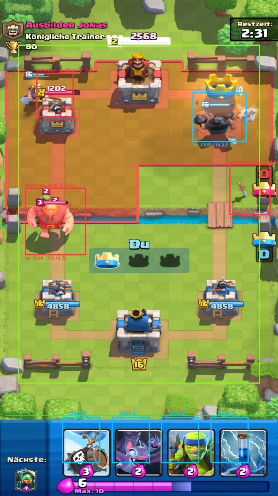

# Clash Royale Tactical AI Bot — MK Miner Skeleton Barrel Zap Bait

A modular, real-time Clash Royale AI bot that plays **on a real Android device over ADB**
(a phone, or BlueStacks / LDPlayer / MEmu / MuMu), using a **Hybrid YOLOv8/ONNX + OpenCV
vision pipeline**, a **utility-scoring & combo-sequencing brain** tuned for the **3.3 Elixir
Mega Knight Zap Bait** deck, and — this is what v2.1 and v2.2 rebuilt — a **capture, touch and
troop-detection layer that actually works on hardware**.

* **v2.1** — capture via `MultiClient`, drag-based touch injection over the scrcpy control socket,
  measured per-device homography calibration, verified deploys.
* **v2.2** — troop detection that works on the *real* sprites: background segmentation instead of
  colour strips, tile-relative geometry instead of emulator constants, real in-game animation
  frames instead of front-facing promo renders, and a **self-supervised identity memory** that
  learns card names from the bot's own verified deploys. Still no training, no annotation, no new
  dependencies. Hand-card recognition on the sample device frame went from 1/4 to 4/4.

| Card | Cost | Tactical Role in the Brain |
| :--- | :---: | :--- |
| **Mega Knight** *(+ Evo)* | 7 | **Defensive Stomp & Counterpush Tank** — Evaluates ground cluster stomp value (`>= 4.0` elixir) on our half before dropping; **never** drops into P.E.K.K.A, onto air troops, or dry in Single Elixir. |
| **Miner** | 3 | **Anti-Tornado Tower Tank & Ranged Sniper** — Rotates across 4 outer King-safe tower tiles so opponents cannot predict-catch or Tornado to King; tanks right before Skeleton Barrel pops; snipes Princess/Magic Archer/Firecracker. |
| **Inferno Dragon** | 4 | **Flanking Tank Melter** — Deploys at outer/high-center safe anchors (`(1.4, 20.5)` / `(7.2, 20.2)`) to melt P.E.K.K.A, Golem, Giant, RG, Lava Hound, and enemy Mega Knights while baiting enemy Zap. |
| **Skeleton Barrel** *(+ Evo)* | 3 | **Primary Bait Win Condition & Opposite-Lane Punisher** — Sequences timed **Barrel -> 1.8s Delayed Miner** combos and punishes the opposite lane whenever the opponent invests 6+ elixir in the back. |
| **Zap** *(+ Evo)* | 2 | **Timed Reset & Swarm Clear** — Waits `~1.7–2.2s` after an enemy Inferno Tower / Inferno Dragon / Sparky locks onto our push before resetting; catches Goblin Barrels & Skarmy; holds Zap when the opponent runs Log Bait. |
| **Bats** *(+ Evo)* | 2 | **High-DPS Air Defense & Bait Punish** — Shreds Balloons & ground rushers; rushes behind Miner/MK whenever the opponent's small spell is tracked out of cycle. |
| **Spear Goblins** | 2 | **Center-Pull Kiter & Anti-Leak Cycle** — Pulls P.E.K.K.A, Prince, Mini P.E.K.K.A, and Bandit to center tiles (`(9.6, 20.6)` / `(8.4, 20.6)`) so **both Princess Towers** shoot them; splits behind King at `9.3+` elixir. |
| **Goblin Gang** *(Goblin Army)* | 3 | **Ground Swarm & Pocket Punisher** — Body-blocks Hog Rider/Ram/Prince (crucial since this deck runs no building!) and pressures unlocked pockets when the opponent's Log/Zap is baited. *(Can be swapped to `skeleton_army` in `configs/mk_zap_bait.yaml`.)* |

---

## What v2.1 fixed (why the old bot "captured the screen but never played")

The original build was tuned against an Android emulator at 720x1280 and worked in its own
benchmark, but on a real ADB device it had four independent defects. Any one of them is enough
to stop it playing; together they made it look completely inert.

| # | Problem | Why it broke real play | What v2.1 does instead |
| :-- | :--- | :--- | :--- |
| 1 | **Card placed with two `input tap`s and a 60 ms gap** | A zero-length `DOWN/UP` pair is routinely dropped by the game, and each `input` call spawns a JVM on the device (~100-250 ms), so the gap was really 300+ ms. Taps landed after the selection had cleared. | Deploys with a **drag gesture** — press the card, glide to the tile, hold, release. That is the gesture the game is designed around. Injected over the **scrcpy control socket** (one persistent connection, sub-10 ms, real press durations), with `input swipe` and `input motionevent` as fallbacks. |
| 2 | **Screen grabbed with `adb exec-out screencap`** | 150-400 ms round trip on a phone. The bot was permanently reasoning about a stale world: reacting to troops that had already moved and mis-reading elixir. | Live H.264 stream via **`MultiClient`** (scrcpy), decoded with PyAV into an always-latest frame buffer at 30-60 fps. Typical decision latency drops to a few milliseconds. |
| 3 | **Arena geometry hard-coded to a 9:16 emulator** | Wrong on every real phone: different aspect ratio, HUD in different places, capture possibly downscaled. And the arena is drawn in **perspective**, so a linear tile→pixel map is off by more than a tile near the enemy side. | Geometry is **measured per device** and stored as a **homography** solved from the four Princess Towers, validated against the detected river. Hand slots, elixir bar and river line come from the frame itself. |
| 4 | **No feedback that a touch registered** | Injected touches fail silently. One dropped play desynchronises the hand model, after which the bot "plays" cards it no longer holds — forever. | Every deploy is **verified**: the hand slot's pixels are re-inspected, and a play that did not register is retried with the next input backend and reported. |

Bonus: the popular `scrcpy-client` Python package packs a **31-byte**
`INJECT_TOUCH_EVENT` payload, but a scrcpy 1.24 server requires exactly **27** bytes. That
desynchronises the control reader and turns every touch into a no-op — a hidden trap for
anyone wiring up scrcpy-based input. This bot therefore never injects touches over a scrcpy
socket: input goes through `adb shell input`, and every deploy is verified on the device
before the hand model trusts it.

---

## Quick Start on a Real Phone

### 1. Prepare the device
1. Enable **Developer options → USB debugging**, plug in the phone, and accept the RSA prompt.
   *Some Xiaomi/Oppo/Vivo devices also need "USB debugging (Security settings)" to allow
   synthetic input.*
2. Keep the phone in **portrait**. The bot pins orientation, but a rotated display breaks
   coordinate mapping.
3. Install Clash Royale and equip the MK Zap Bait deck.

### 2. Install
```bash
pip install -r requirements.txt        # opencv, numpy, pyyaml, pillow, av, pytest
```

Check the link end to end:
```bash
python main.py --stats
```
This prints the detected device, resolution, whether Clash Royale is in the foreground, and
which capture/input backends will be used.

### 3. Calibrate once per device (15 seconds)
Open a **battle** (Training Camp is free) and run:
```bash
python scripts/calibrate_device.py
```
The bot detects the river, your four hand cards, the elixir bar and the towers, then writes
`configs/calibration/<device>_<WxH>.json` plus a `.preview.png`.

**Open the preview and check it.** You should see the yellow grid following the arena, the
cyan boxes sitting exactly on your four cards, and the red line lying on the river. If not,
click the towers yourself — that is exact:
```bash
python scripts/calibrate_device.py --manual
```
Headless (SSH)? Pass the four Princess Tower bases as coordinates:
```bash
python scripts/calibrate_device.py --towers "140,300;580,300;140,745;580,745"
```

### 4. Prove that touches land
```bash
python scripts/probe_placement.py
```
This tries each input backend in turn, drags your first card onto a safe tile and reports
whether the card **actually left the hand**. It writes `probe_placement.png` showing exactly
the gesture it sent. If everything says `NO-OP`, the script prints a checklist — in practice
it is nearly always an uncalibrated tray or input injection disabled at the OS level.

### 5. Play
```bash
python main.py                  # you start the battle; the bot plays it
python main.py --auto-queue     # bot also clicks Battle / OK between matches
python main.py --dry-run        # live coach: shows what it *would* play, taps nothing
```
Press `q` in the HUD window or `Ctrl+C` to stop.

---

## Using `MultiClient` directly

`cr_bot.adb.capture.MultiClient` is the capture layer. It manages one session per device and
keeps an always-latest frame:

```python
from cr_bot.adb.capture import MultiClient

mc = MultiClient(target_width=720, max_fps=30)      # or MultiClient(serials=["R58M…", "10.0.0.5:5555"])
mc.start()

frame = mc.latest_frame()                            # newest BGR frame, never a stale one
print(mc.resolution, f"{mc.fps:.1f} fps", mc.backend_used)

mc.stop()
```

Backends (`capture.backend`):

| Value | What it does |
| :--- | :--- |
| `auto` *(default)* | `screenrecord` → `scrcpy_py` → `screencap`; the first one that delivers frames wins. |
| `screenrecord` | Android's own binary: H.264 at display rate, no server jar, nothing version-specific. |
| `scrcpy_py` | The `scrcpy` PyPI package (py-scrcpy-client), if it is installed. It pushes its own server jar. |
| `screencap` | Legacy `adb exec-out screencap` polling — slow, but a useful way to prove ADB itself is healthy. |

**No scrcpy server jar is bundled and no scrcpy wire protocol is implemented here.** A
hand-maintained server became stale every time Android changed its encoder rules, and the
failure mode was silent (server starts, prints its device line, never sends a frame). The two
paths above cover the same need with nothing version-sensitive in the repository: `screenrecord`
ships with Android, and `scrcpy_py` brings its own jar.

---

## How placement works

```
brain decides tile (e.g. left bridge 3.5, 16.9)
        │
        ├─ homography  tile → frame pixel        (perspective-correct, per-device calibration)
        ├─ legality gate                          (below the river, inside the arena, off the HUD)
        ├─ drag gesture                           scrcpy control socket → input swipe → motionevent → tap
        └─ verification                           did that hand slot's pixels change?
                 ├─ yes → confirmed
                 └─ no  → retry with the next backend, then report
```

Every step is independently testable, and the calibration is inspectable as an image rather
than being a set of magic constants.

---

## Project Structure

```text
cr-bot/
├── configs/
│   ├── mk_zap_bait.yaml           # deck, ADB, capture, input, vision & tactical tuning
│   └── calibration/               # per-device measured geometry (+ preview PNGs)
├── cr_bot/
│   ├── adb/
│   │   ├── adb_utils.py           # device discovery, resolution, rotation, screen wake
│   │   ├── capture.py             # MultiClient: screenrecord / scrcpy_py / screencap + H.264
│   │   ├── touch.py               # backends, drag/place gestures, escalation
│   │   └── controller.py          # facade used by the runner
│   ├── arena/
│   │   ├── projection.py          # tile<->pixel homography / rect projection
│   │   ├── grid.py                # 18x32 grid, tactical anchors, deploy legality
│   │   └── device_calibrator.py   # measures river / cards / elixir / towers + preview
│   ├── vision/
│   │   ├── arena_detector.py      # detector facade: segmentation + bars + identity + tracker
│   │   ├── unit_detector.py       # background model, blob segmentation, bars, size classes
│   │   ├── unit_identity.py       # self-supervised card identity memory (from verified deploys)
│   │   ├── sprite_matcher.py      # masked-ZNCC matching against real in-game sprite frames
│   │   ├── game_state.py          # phases, 1x/2x/3x, 6-tower HP
│   │   ├── elixir_tracker.py      # continuous elixir fill reader + opponent cycle
│   │   ├── hand_detector.py       # 4-slot recogniser + deck elimination
│   │   └── deploy_verifier.py     # "did the card really leave the hand?"
│   ├── brain/                     # utility planner, threat analysis, pending tracking
│   ├── sim/                       # tick-accurate benchmark engine
│   ├── ui/debug_hud.py            # live tactical overlay
│   ├── ui_window.py               # fits every preview window to the desktop
│   └── bot_runner.py              # main control loop
├── scripts/
│   ├── calibrate_device.py        # auto / manual / from-image calibration
│   ├── probe_placement.py         # "which touch backend actually places cards?"
│   ├── fetch_card_assets.py       # official portraits -> assets/card_art + card_templates
│   ├── fetch_game_sprites.py      # real in-game animation frames -> assets/unit_sprites
│   ├── capture_templates.py       # alternative: slice templates from your own device
│   ├── run_benchmark.py           # 340-match tournament benchmark
│   └── train_yolo.py              # train/export custom troop weights
├── assets/
│   ├── card_art/                  # official card portraits (89)
│   ├── card_templates/            # hand-slot templates derived from the portraits (89)
│   └── unit_sprites/              # real in-game troop frames (53 cards) + contact sheet
├── tests/                         # 59 unit, vision, protocol & full-match tests
└── main.py
```

---

## Troubleshooting

| Symptom | Cause | Fix |
| :--- | :--- | :--- |
| `No Android device found over ADB` | USB debugging off, or RSA prompt not accepted | Re-plug, accept the prompt on the phone, re-run `adb devices` |
| **`scrcpy did not send its handshake byte`** | Almost always a **stale scrcpy server** from a crashed run still holding `localabstract:scrcpy`, or a **v1.24 server on Android 13+**. Occasionally a truncated jar push. | The bot now kills stale servers, re-pushes, retries once, prints **the server's own error**, and **falls back to `screencap`** so you can still play. Read the printed advice; `adb shell pkill -f com.genymobile.scrcpy` clears it manually. |
| `foreground: ?` / `clash royale: NO` while the game is open | Older builds only read `mResumedActivity`, which Android 12+ renamed | Fixed: `topResumedActivity`, `mResumedActivity`, `mCurrentFocus` and `mFocusedApp` are all probed |
| `scrcpy stream up` immediately followed by `scrcpy video stream ended`, then `started but produced no frame` | A **1.x server on Android 13+**: the sockets open, then the display-capture API it uses no longer works | Fixed: **v5.0.1 is bundled** and used by default; a dead stream now fails the start (instead of looking healthy) and falls back to `screencap` |
| Playing a custom APK / private server | Application id is not `com.supercell.clashroyale` | Add it to `game.packages`, or pass `--package <id>` — see the custom-APK section above |
| Capture works, nothing is ever played | Touch injection ignored by the OS | `python scripts/probe_placement.py`. On Xiaomi/Oppo/Vivo enable *USB debugging (Security settings)* |
| Cards play, but land a tile off | Stale or low-confidence calibration | Re-run `scripts/calibrate_device.py`, check the preview, or use `--manual` |
| Plays the wrong card | Hand slots misaligned | Same as above — the cyan boxes must sit on the cards |
| HUD preview is slow / laggy | HUD rendering in Python | `python main.py --no-hud`, or lower `capture.width` |
| `scrcpy server exited immediately` | adb/server mismatch | `python main.py --capture screencap` to confirm ADB is fine, then check the jar |
| Clicks land on the menu after a match | Phase detection missed the transition | Use `--no-hud` and watch the logs, raise `tactics.min_action_cooldown_sec` |

Useful flags: `--recalibrate`, `--no-calibrate`, `--no-verify`, `--input swipe`,
`--deploy-style tap`, `--log-level DEBUG`.

`python main.py --stats` is the first thing to run when anything misbehaves: it reports the device,
the foreground app, then **probes the capture path** (starts the backend, grabs a frame, measures
fps) and exits — no traceback, ever, and no half-started bot. If live scrcpy cannot come up it
explains why and the bot continues on the `screencap` fallback (~5-10 fps) instead of refusing to
run.

### Capture backends: what you actually get

The bot walks a **ladder** and stops at the first rung that delivers frames. All three play
the game; only reaction time and input latency differ.

| # | Backend | Frame rate | Input | When it is used |
| :-- | :--- | :--- | :--- | :--- |
| 1 | `screenrecord` | 25-30 fps | `adb shell input` | default; Android's own binary, needs **no server jar** |
| 2 | `scrcpy_py` | 30-60 fps | `adb shell input` | if the `scrcpy` PyPI package is installed; it pushes its own jar |
| 3 | `screencap` | ~1 fps on a 1080p phone | `adb shell input` | last resort, or `--capture screencap` |

Rung 1 is Android's own `screenrecord` binary, which is already on every device from 4.4 up.
It streams the same H.264 a scrcpy server would, without a socket handshake, a bundled jar, or
any Android-version coupling — which is why a phone that used to fall all the way to `screencap`
now gets near-full frame rate.

```bash
python main.py --capture auto          # the ladder above (default)
python main.py --capture screenrecord  # force Android's tool
python main.py --capture scrcpy_py     # force the scrcpy library, if installed
python main.py --capture screencap     # force the slow, always-works path
```

The live backend is reported on connect and in `--stats`, and
`python scripts/check_capture.py` measures them side by side.

---

## Custom APKs, private servers and "Nulls Royale"

Private-server builds (Nulls Royale, modded clients, re-signed APKs) are **the same game with a
different application id**. The bot therefore never compares against `com.supercell.clashroyale`
directly: it keeps a list of ids plus substring hints, and any build matching either counts as
"the game".

```yaml
game:
  packages:                       # exact application ids
    - "com.supercell.clashroyale"
    - "nullsroyale.rel.free"
  package_hints:                  # any substring, case-insensitive
    - "clashroyale"
    - "clash_royale"
    - "nullsroyale"
```

```bash
python main.py --stats                       # reports: clash royale: yes (nullsroyale.rel.free)
python main.py --package org.custom.client   # anything else, no config edit needed
python main.py --launch                      # bring the configured build to the foreground
```

`--stats` also *searches the device*: if the game is installed but not in front it names the
package it found instead of asking you to open "Clash Royale" by name.

What is identical and what can differ:

| | Stock app | Custom build |
| :--- | :--- | :--- |
| Arena geometry, card art, elixir bar, HUD layout | same | same — vision is pixel-based, no OCR of the title, no package lookups |
| Hand cards, elixir, troop detection, calibration | works | works |
| Application id / app label / icon | `com.supercell.clashroyale` | configured list above |
| Optional extras (mod menus, watermarks, extra buttons) | absent | anything drawn **over the arena** will be seen as an obstacle; keep overlays off the battlefield |

If your build's id matches nothing in the list, `--package <id>` is enough — no code change.

---

## Capture backends without a bundled server

Earlier versions shipped `scrcpy-server-*.jar` files and a hand-written protocol reader. Both
are gone, for three reasons that all showed up on real hardware:

* a server jar is only correct for the Android releases it was built against; on Android 13+
  a stale one starts, prints `Device: …`, and then never produces a frame;
* vendor encoders (Samsung, in particular) reject a 720p/30 H.264 configuration that older
  Android accepted, and the server reports nothing;
* every workaround had to be re-derived for each new release.

The replacement is Android's own `screenrecord`, which is already on the phone and streams the
same H.264 without any handshake. `MultiClient` measures it against `screencap` and reports the
winner in `--stats`; `scripts/check_capture.py` measures every backend side by side:

```bash
python scripts/check_capture.py --seconds 6
```

---

## Troop detection on real sprites (no training, no labelling)

The v2.2 target was: *recognise the troops that are actually on the arena, on a real device, without
training or annotating anything locally.* That turned out to be two separate problems, and only one
of them is a matching problem.

### 1. Finding troops — segmentation, not colour thresholds

The arena is a **static scene**: floor, bridges, towers and chests never move, only troops do. So
the bot keeps a running model of the floor and thresholds the difference
(`cr_bot/vision/unit_detector.py`):

```
frame ──► ArenaBackgroundModel.foreground() ──► morphology ──► blobs ──► tile-space unit
          (selective update:                                    │
           stationary troops are never absorbed)                ├─ bbox        → size class (tiles)
                                                                ├─ mean tint  → side (blue = you)
                                                                ├─ foot point → tile (x, y)
                                                                └─ nearby bar → HP fraction
```

Why this beats the old colour-strip detector:

* **Nothing is hard-coded in pixels.** Every limit is expressed in *tiles* through the calibrated
  projection, so 720p, 1080p and 1440p captures behave identically. The old code assumed a 720p
  emulator (`foot_y = bar_y + 26`, bar widths `>= 48/28/18`) and simply drifted on a phone.
* **The arena floor stops generating false positives.** A loose red/blue threshold matches grass,
  the river, bridge planks and tower roofs; frame differencing does not.
* **You get a real bounding box**, so size (→ `swarm / light / medium / heavy`) and position come
  from the sprite itself instead of being guessed from a health bar's width.
* Cost is ~9 ms/frame at 720x1280, because segmentation runs on a half-resolution copy of the arena.

Health bars are still read, but only to refine **side** and **HP fraction** — and with their dark
outline required, and their geometry in tiles (`HealthBarReader`), rather than as the detector.



*`scripts/inspect_detection.py` on the sample 720x1280 frame: four troops segmented, each boxed with
side, height class, HP and tile position. The Mega Knight on the right lane is correctly attributed
to **ally** because its health bar (cyan) is matched to its box; the Giant on the left is **enemy**
(red bar), 4.6 tiles tall, i.e. a heavy tank. Run the same command with `--serial <your device>` to
see this live on your phone.*

### 2. Naming troops — match *the game's* art, or learn it from the device

This is where the honest answer matters. The obvious reference set — the promo renders at
`cdn.royaleapi.com/static/img/cards/<slug>.png` — **does not work**. Those are front-facing studio
shots; the arena draws small, top-down, team-tinted animation frames. Measured on the two units of
the sample device frame whose identity is known (Mega Knight on the right lane, Giant on the left),
the correct card ranked **34 of 78** — chance — across grayscale ZNCC, edge ZNCC, CLAHE variants,
sliding and fixed-window matching. No score tuning fixes a pose mismatch, so that library was
deleted instead of being shipped.

Two things replace it:

**Real in-game animation frames** (`scripts/fetch_game_sprites.py` → `assets/unit_sprites/`).
Supercell pre-renders every animation, and the decrypted `*_tex.sc` dumps are public. The script
downloads a spread of frames per character, rejects attack-arc effects, detached limbs and clipped
cells by silhouette statistics, then keeps a diverse subset (farthest-point sampling) — 53 cards,
~8 poses each, both team tints, 4.7 MB, all committed. `SpriteMatcher` scores them with an exact
**masked ZNCC** (`cr_bot/vision/sprite_matcher.py`); on a *known* bounding box every card competes
for the same box, which is far more discriminative than free sliding.

**Self-supervised identity memory** (`cr_bot/vision/unit_identity.py` → `assets/unit_identity/`).
The bot already knows, with certainty, which card it just played and where: the deploy was verified
by re-inspecting the hand. So a second later it crops whatever troop is standing at the drop point
and files it under that card's name in `UnitIdentityMemory`. That is **exactly labelled, real-sprite
data for free** — no annotation, no training, no GPU; the "model" is a handful of 40x48 crops from
*this* device, resolution and UI language. Because the opponent's copy of a troop is the same model
tinted red, the samples also recognise enemy units. `match()` returns `None` when the score or the
margin is weak, so the bot falls back to the size-based `unknown_*` label instead of guessing.

Practical consequence: identity starts at "unknown, medium, 2.4 tiles tall, enemy, left lane" — which
is already what the brain consumes to choose a counter — and sharpens into card names over the first
match or two. To seed it faster, play a couple of matches with the same deck.

```bash
python3 scripts/fetch_game_sprites.py --contact-sheet   # rebuild the sprite library (network)
python3 scripts/fetch_card_assets.py                    # portraits + hand-slot templates
```

Set `vision.identity_learning: false` in the config to disable learning; delete
`assets/unit_identity/` to forget everything.

### 3. Hand cards — the old templates were the problem

`assets/card_templates/` used to hold 96x116 crops sliced out of a low-res emulator screenshot:
blurred, with the card border and elixir bubble baked in. Measured on the sample device frame they
identified **1 of 4** hand cards. They are now generated from the official portrait art
(`scripts/fetch_card_assets.py`, 72x86, 89 cards), and the recogniser restricts candidates to the
deck it is actually playing before applying deck elimination. On the same frame: **4 of 4**
(Skeleton Barrel, Bats, Spear Goblins, Zap), with the runner-up 0.15-0.25 behind.

### Optional: YOLOv8 troop recognition

Segmentation + identity learning needs no weights at all. If you *do* have a Clash Royale YOLO
model, `HybridArenaDetector` will fuse it: drop it at `weights/clash_yolov8n.onnx` (with a matching
`.names` file) or pass `--yolo-weights path/to/best.pt`. It is not required, and training one is not
part of the workflow this repo recommends.

---

## Empirical Proof: 340-Match Tournament Benchmark

`cr_bot/sim/` is a tick-accurate Level 11 Tournament Standard engine (real HP/DPS/sight
ranges, 8-card FIFO cycle, Evolutions, 1x/2x/3x elixir, Overtime & Tiebreaker, Mega Knight
jump/stomp, 3-stage Inferno ramp & stun resets, Skeleton Barrel death spawn, Golem split, Log
knockback, strict fog of war) with four meta-archetype opponents.

Across **340 full matches** (all bots piloting the same deck). The headline configuration is
**unchanged by the v2.1/v2.2 real-device and detection work** — same 66/80, same per-matchup
splits:

| Bot Configuration | Overall Win Rate | vs Hog 2.6 | vs Log Bait | vs P.E.K.K.A BS | vs Golem | Avg Crown Diff |
| :--- | :---: | :---: | :---: | :---: | :---: | :---: |
| **v2.0 MK Zap Bait (`180ms` ADB Lag + Noisy Hybrid Vision + `5%` Dropped Taps)** | **82.5%** (`66/80`) | **100%** | **80%** | **95%** | **55%** | **`+1.30`** |
| **v2.0 MK Zap Bait (Zero-Weight `720×1280` Raw Pixels + `200ms` Lag — No YOLO)** | **55.0%** (`11/20`) | 60% | 20% | 80% | 60% | `-0.30` |
| **v2.0 MK Zap Bait (Ideal `0ms` Fog-of-War Upper Bound)** | **78.8%** (`63/80`) | **100%** | **65%** | **100%** | **50%** | **`+1.14`** |
| **Naive Bridge-Spam Script Bot (Same Deck)** | **21.2%** (`17/80`) | 40% | 5% | 30% | 10% | `-1.07` |
| **Random Valid-Play Baseline (Same Deck)** | **8.8%** (`7/80`) | 20% | 0% | 5% | 10% | `-1.74` |

Re-run with `python scripts/run_benchmark.py`, then open `benchmark_report.html`.

> Note: the simulator validates the *decisions*. It cannot validate the *device link* — that
> is what `scripts/probe_placement.py` and the deploy verification loop are for.
>
> Why the "zero-weight raw pixels" row dropped from 75.0% to 55.0%: that variant feeds the brain
> *only* what the pixel detector reports, on a 20-match sample (3 matches = 15 points). Its old
> score was produced by a detector whose weight classes came from hard-coded 720p bar widths
> (`>= 48 / 28 / 18 px`) — and the simulator draws its health bars scaled by weight class, i.e.
> the old detector and the simulator were fitted to each other. The new detector derives the weight
> class from the segmented sprite's height in *tiles*, so it agrees with the engine's own unit
> sizes but no longer with the bar-width encoding. On a real device the tile-based reading is the
> correct one; the synthetic variant is a smoke test, not a real-device measurement. The
> 340-match headline configuration is unchanged.

---

## Running the Tests

```bash
pytest -v
```
59 tests: scrcpy protocol layout, coordinate mapping, backend escalation, projection
(incl. perspective round-trip), calibration serialisation, deploy verification, elixir
reading, background segmentation, tile-relative size classes, health-bar reading at multiple
resolutions, masked ZNCC, identity-memory learning/persistence/namespacing, hand templates,
plus the original vision and full-match simulation suites.

The device tests run against `calibration_preview.png` — a genuine 720x1280 Clash Royale
battle frame — and assert measured facts rather than renderer assumptions:

* layout: river at y≈567, card centres at 224/360/496/631, cards ≈127x114;
* the four hand cards really in the tray are **Skeleton Barrel, Bats, Spear Goblins, Zap**, and
  `HandCardDetector` must return exactly that;
* a troop pasted into the arena must be segmented at the right place, with the right side and a
  height-derived weight class, and must keep being detected after it stops moving;
* a troop the bot has "deployed" must become recognisable by name once a sample has been filed.
